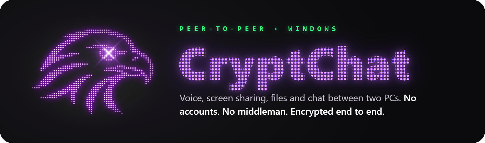
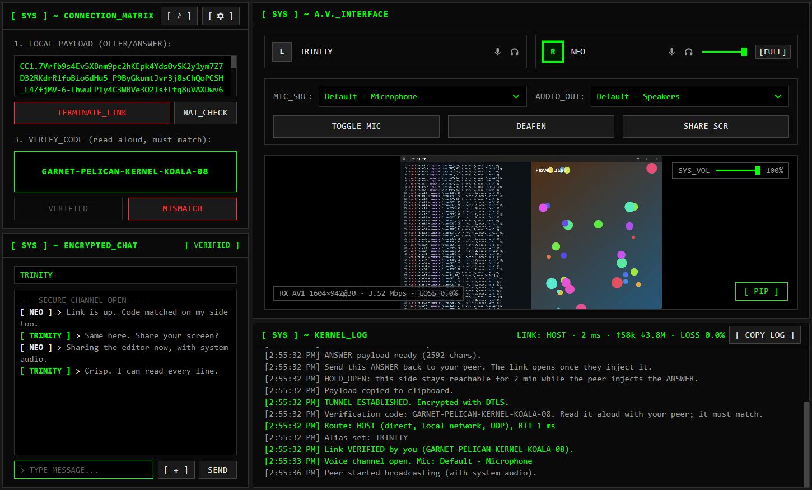

<p align="center"></p>

<p align="center">
  <a href="CHANGELOG.md"></a>
  <a href="https://github.com/kylehesi/cryptchat/actions/workflows/test.yml"></a>
  <a href="LICENSE"></a>
  
  
</p>

<p align="center">
  <b><a href="#download">Download</a></b> · <a href="#features">Features</a> · <a href="#how-it-works">How it works</a> · <a href="#security-honestly">Security</a> · <a href="docs/ARCHITECTURE.md">Architecture</a> · <a href="CHANGELOG.md">Changelog</a>
</p>

CryptChat connects two Windows PCs directly for **voice calls, screen sharing with system audio,
file transfer and chat**. You swap two codes through any messenger, and from then on everything
flows straight between the two machines, encrypted. No account, and no server of ours in
between: public STUN servers only tell each PC its own address, and a TURN relay is used only if
you set one up.

It exists because most call apps want an account first and route every word through someone
else's machines. CryptChat needs neither, and it shows you what it is doing: the route, the
encryption, and a code to read aloud that proves nobody is listening in.

<p align="center"></p>

## Features

<table>
  <tr><td width="31%"><b>No account, no middleman</b></td><td>You swap two codes through any messenger and the call runs PC to PC. Nothing to sign up for, nothing kept on anyone's server.</td></tr>
  <tr><td width="31%"><b>Screen sharing that stays sharp</b></td><td>AV1 keeps small text readable even on a 1 Mbps link. Share a window or a whole screen with its sound, without your friend hearing their own voice back, and switch what you share without stopping.</td></tr>
  <tr><td width="31%"><b>Proof nobody is listening</b></td><td>Both sides see a code (four words and a number) derived from the encryption keys. Read it aloud: if it matches, nobody is in the middle.</td></tr>
  <tr><td width="31%"><b>Files of any size</b></td><td>Streamed straight to disk once you accept, never overwriting anything, and marked as downloaded from the internet.</td></tr>
  <tr><td width="31%"><b>Tells you what your network needs</b></td><td>NAT_CHECK says before you start whether you need a TURN relay. HOLD_OPEN keeps a direct link possible while your friend pastes the code. RELAY_ONLY hides your IP address.</td></tr>
  <tr><td width="31%"><b>Safe to stream</b></td><td>One switch hides IP addresses and codes on screen. COPY_LOG copies a bug report with personal details masked.</td></tr>
</table>

## Download

Get **`CryptChat-Setup-<version>.exe`** from [Releases](https://github.com/kylehesi/cryptchat/releases)
and run it. It installs for your user only and never asks for administrator rights.

> [!NOTE]
> Builds are not code-signed yet. Windows shows *"Windows protected your PC"*: click
> **More info → Run anyway**. On Windows 11 PCs with **Smart App Control** on, unsigned apps
> are blocked outright; run it [from source](#build-from-source) until signed builds arrive
> ([why](docs/RELEASING.md#why-windows-warns-and-how-to-stop-it)).

## How it works

1. **You** press **GENERATE_PAYLOAD** and send the code to your friend (any messenger works).
2. **Your friend** pastes it, presses **EXECUTE_CONNECT**, and sends their answer code back.
3. **You** paste the answer and press **EXECUTE_CONNECT**. The encrypted tunnel opens.
4. **Both** read the **VERIFY_CODE** aloud (four words and a number). Same code? Then nobody is
   in between.

Most home networks connect directly. Press **NAT_CHECK** first to know whether yours does; if
it says TURN, add a Cloudflare TURN key or your own server under **[ ⚙ ] → NETWORK**
([guide](docs/TURN.md)). Traffic stays end-to-end encrypted through the relay.

## Security, honestly

- Everything is encrypted (WebRTC DTLS-SRTP). There is no unencrypted mode.
- By default **your peer can see your public IP address**. **RELAY_ONLY** hides it behind TURN.
- The **verification code** detects tampered payloads (a man in the middle).
- Files are saved only after you accept them, into `Downloads\CryptChat`, marked as downloaded
  from the internet.
- Settings, TURN secrets included, are encrypted on disk with Windows DPAPI.
- CryptChat is **not** an anonymity tool.

Details in [ARCHITECTURE.md](docs/ARCHITECTURE.md). Found a vulnerability? See [SECURITY.md](SECURITY.md).

## Build from source

Needs Windows 10/11, [Node.js LTS](https://nodejs.org) and [Git](https://git-scm.com).

```bat
git clone https://github.com/kylehesi/cryptchat.git
cd cryptchat
start.cmd
```

`start.cmd` installs the dependencies on the first run, then starts the app. `npm test` runs
the test suite, `npm run dist` builds the installer ([RELEASING.md](docs/RELEASING.md)).

## Documentation

| Document | What it covers |
|---|---|
| [CHANGELOG.md](CHANGELOG.md) | What changed in each version |
| [docs/ARCHITECTURE.md](docs/ARCHITECTURE.md) | How it works inside: WebRTC, signaling, audio, security model |
| [docs/TURN.md](docs/TURN.md) | When you need a TURN relay, and how to set one up |
| [docs/TODO.md](docs/TODO.md) | What is planned next |
| [CONTRIBUTING.md](CONTRIBUTING.md) | How to report bugs and send changes |

## License

[MIT](LICENSE): use it, change it, share it, keep the copyright notice. Versions up to v0.2.3
were released under GPL-3.0. The installer bundles [Electron](https://www.electronjs.org) (MIT)
and Chromium, whose licenses ship next to the app.
